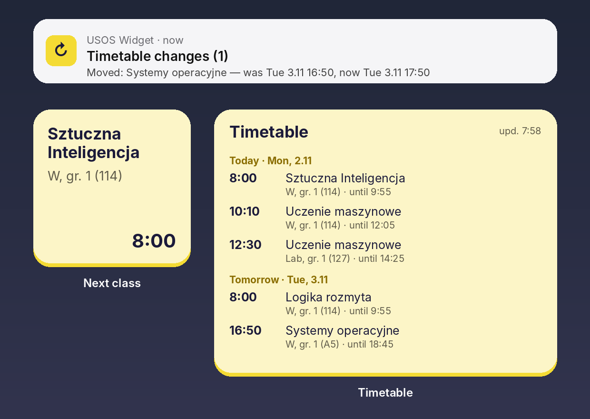
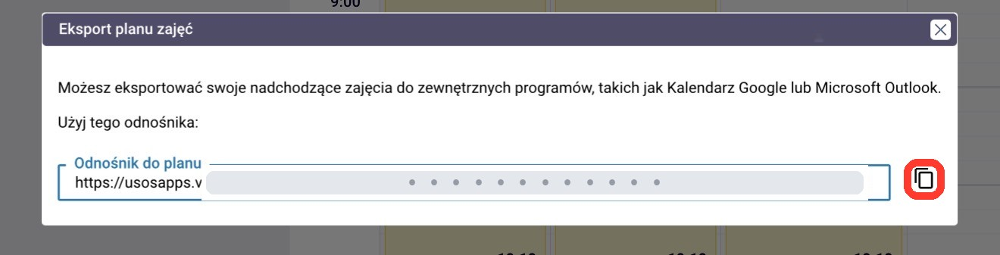
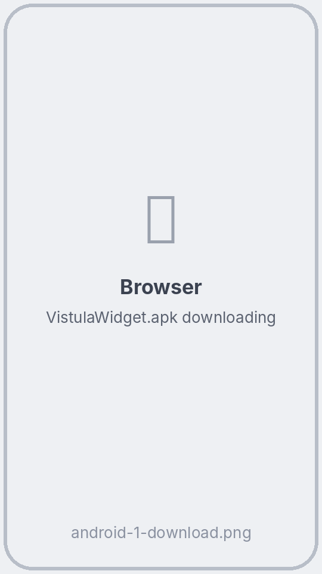
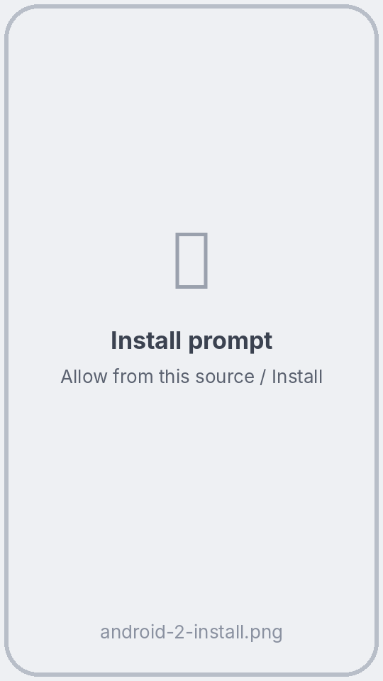
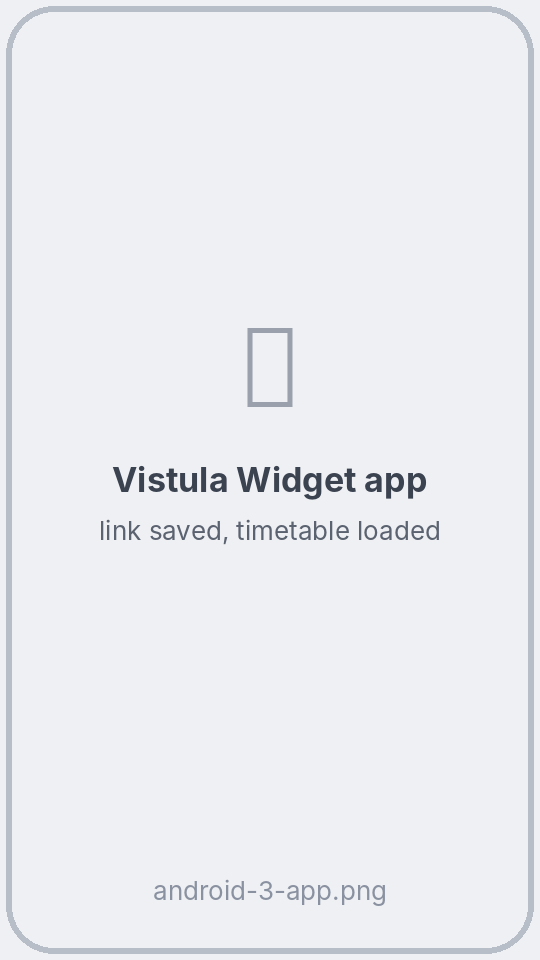
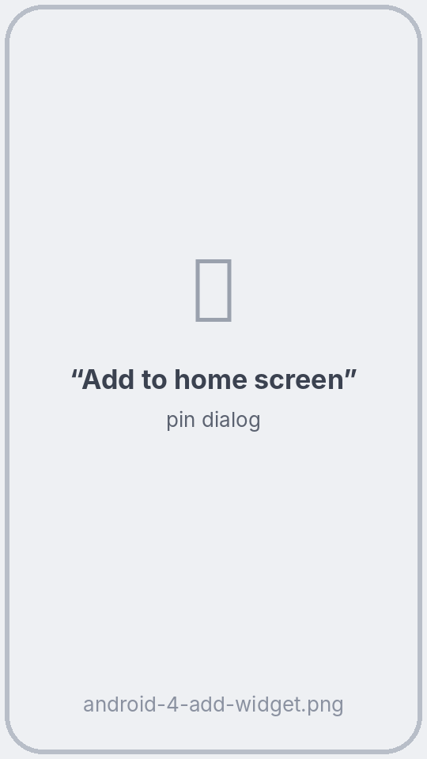
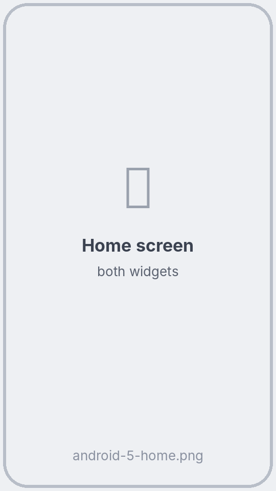

<div align="center">

# 📅 USOS Widget for Android

**Your USOS timetable right on the home screen — for students of any university that uses USOSweb.**

**English** · [Polski](README.pl.md) · [Українська](README.uk.md) · [Русский](README.ru.md)

[](https://github.com/ProstoKery/usos-widget-android/actions/workflows/build.yml)
[](https://github.com/ProstoKery/usos-widget-android/actions/workflows/e2e.yml)




### [⬇ Download UsosWidget.apk](https://github.com/ProstoKery/usos-widget-android/releases/latest/download/UsosWidget.apk)

Have an iPhone? → **[USOS Widget for iPhone](https://github.com/ProstoKery/usos-widget-ios)**

</div>

---

## ✨ What it does

- 🕗 **Next class** — a small widget with your current or next class: course, type, group, room and time.
- 🗓 **Timetable** — a scrollable widget with all upcoming classes, grouped by day.
- 🔔 **Change alerts** — a notification when a class in the next 7 days is **moved, cancelled, added or changes room**.
- 🌍 **Your language** — Polski, English, Українська, Русский (follows the phone).
- 🔐 **No login** — the app never asks for your password. It uses the private calendar link from USOSweb.

## 📲 Setup — about 5 minutes

### Step 1. Copy your timetable link from USOSweb

Do this on your phone, in Chrome or any other browser. The screenshots show one university's USOSweb — yours looks the same or very similar.

1. Open your university's USOSweb (for example **usosweb.uw.edu.pl** or **usosweb.vistula.edu.pl**) and tap **Zaloguj się**. Sign in with your university account.

2. At the top open **MÓJ USOSWEB**, then on the left **PLAN ZAJĘĆ**. If you don't see the top menu, tap **☰** or turn the phone sideways.

   

3. Tap **eksportuj** in the top-right corner.

   

4. The **Eksport planu zajęć** window opens. Tap the copy button next to the link. The link contains `/services/tt/upcoming_ical?`

   

> 🔒 Anyone with this link can see your timetable. Don't post it in group chats.

### Step 2. Install the app

1. On your phone tap **[UsosWidget.apk](https://github.com/ProstoKery/usos-widget-android/releases/latest/download/UsosWidget.apk)** — the download starts.

   

2. Open the downloaded file. Android asks whether your browser may install apps: tap **Settings** → turn on **Allow from this source** → go back → **Install**.

   If Google Play Protect warns about an unknown app, tap **More details** → **Install anyway**. The app isn't in Google Play, which is why you see the warning. All of its code is in this repository.

   

### Step 3. Paste the link

Open **USOS Widget**, paste the link into the field and tap **Save and refresh**. When Android asks about notifications, tap **Allow** — that's how you'll hear about timetable changes.

> 💡 Instead of copying, you can also use **Share** on the link and pick **USOS Widget**.



### Step 4. Add the widgets

In the app tap **Add “Next class”** and/or **Add “Timetable”**, then **Add to home screen**.

Or the usual way: long-press an empty spot on the home screen → **Widgets** → **USOS Widget** → drag a widget onto the screen.

 

### Step 5. Xiaomi, Huawei, Samsung and others: allow background work

Some phones stop background work of apps you rarely open, and the widget then stops updating. In the app tap **App settings** → **Battery** → **Unrestricted**. On Xiaomi also turn on **Autostart**.

## 🔄 How the widget updates

The widget is a picture that the app draws in the background. **Looking at it doesn't trigger anything**: the phone shows the last version the app drew.

| What changes | When |
|---|---|
| The next class switches, the “now” mark moves | Exactly when a class starts or ends (as soon as the screen is on) |
| New data from USOS | About every 30 minutes. While the phone lies asleep, Android may postpone this until you use it again |
| Right now | Tap the widget — the app opens and downloads the timetable immediately |
| Change notification | When a download finds a class in the next 7 days moved, cancelled, added or in another room |

## ❓ FAQ

**The widget says “No connection to USOS”.** Check the internet. USOS may also be down for a while — the last downloaded timetable stays on the widget.

**I see someone else's timetable.** The link belongs to someone else. Copy your own link (step 1) and paste it in the app again.

**How do I change the language?** The app follows the phone language. On Android 13 or newer you can also choose it separately: **Settings → Apps → USOS Widget → Language**.

**How do I update the app?** Download the new **UsosWidget.apk** from the link above and install it over the old one. Your link stays saved.

**How do I remove it?** Uninstall it like any other app. Nothing is stored anywhere except your phone.

## 🔒 Privacy

- The app talks only to your university's USOS server — the address in your link. No accounts, no analytics, no ads.
- Your link is stored only on your phone. The app never shows it in full, so screenshots of the app are safe to share.

## 🛠 For developers

```bash
./gradlew :app:testDebugUnitTest :app:assembleDebug
# APK: app/build/outputs/apk/debug/app-debug.apk
```

- No libraries — only the Android framework and the Kotlin standard library. Android 8.0+ (API 26), target API 35.
- Unit tests: [`app/src/test`](app/src/test) — the USOS calendar parser and change detection.
- [Emulator test](.github/workflows/e2e.yml) on every push: installs the app on Android 15, serves a demo timetable, renders both widgets, checks the change notification and all four languages, and saves screenshots of every step to the [`e2e-screenshots`](../../tree/e2e-screenshots) branch.
- A release with the APK is published when a `v*` tag is pushed.

```
app/src/main/java/pl/kera/usoswidget/
├── Ics.kt           # downloads and parses the USOS iCalendar link
├── Refresh.kt       # background refresh (JobScheduler), change detection, notifications
├── Widgets.kt       # both widgets, date formatting
├── MainActivity.kt  # the only screen
└── Store.kt         # local storage
```

## ⚠️ Disclaimer

An unofficial student project, not affiliated with the USOS team (MUCI) or any university. Tested at Vistula University; it should work wherever USOSweb lets you export your timetable.

## 📄 License

[MIT](LICENSE) © 2026 Kyrylo Serhiienko
