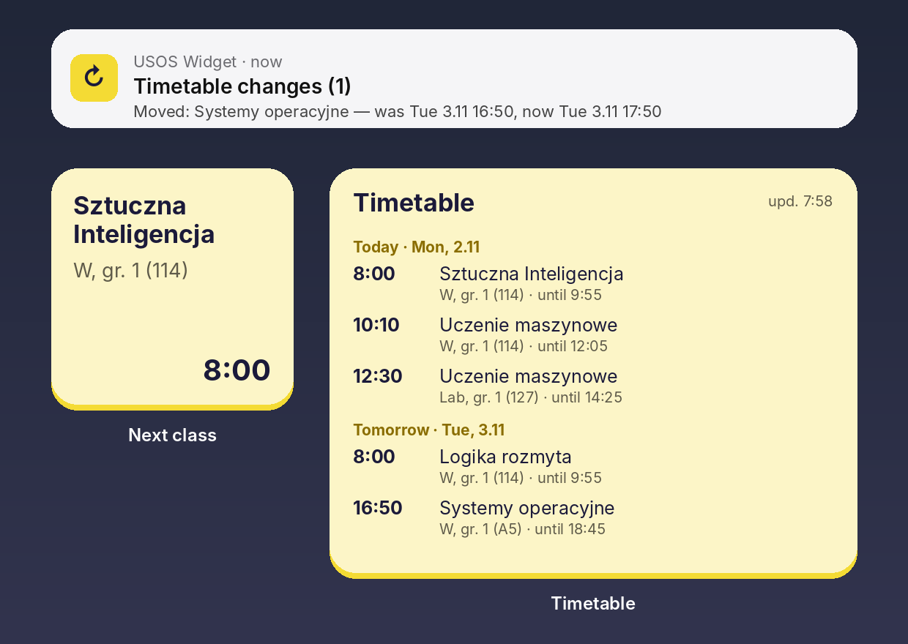
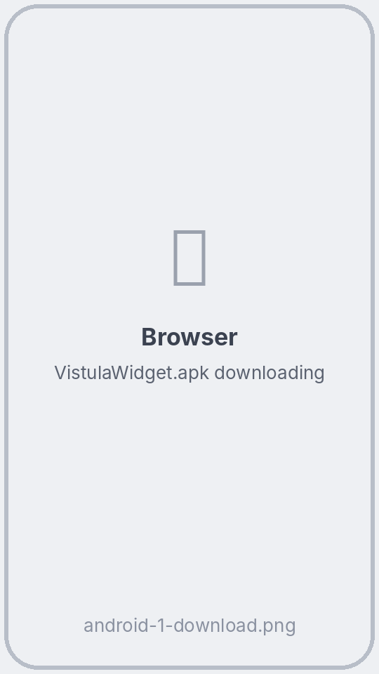
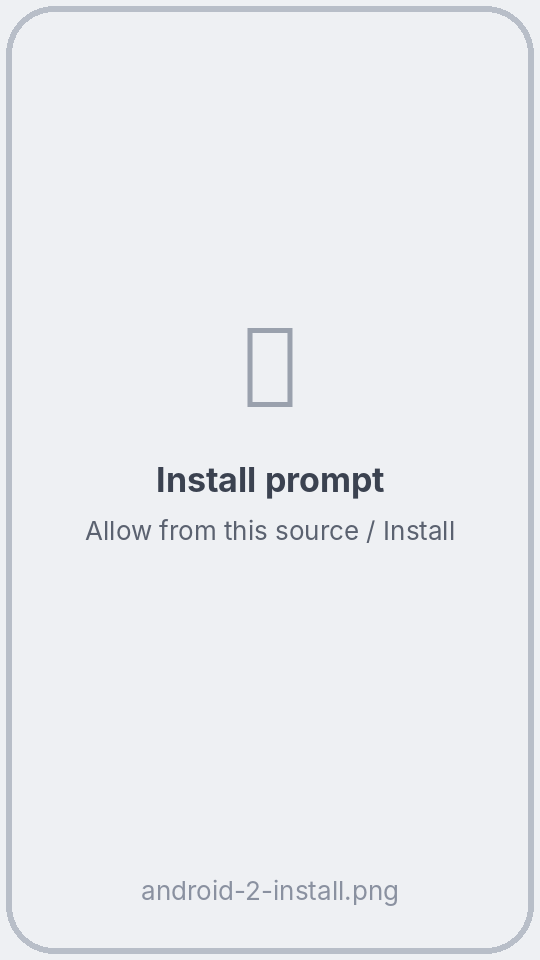
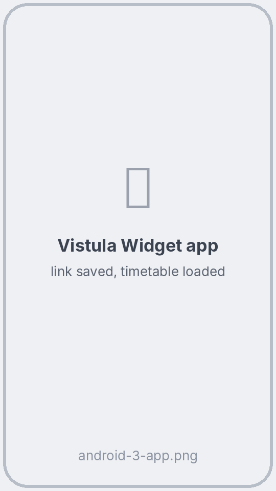
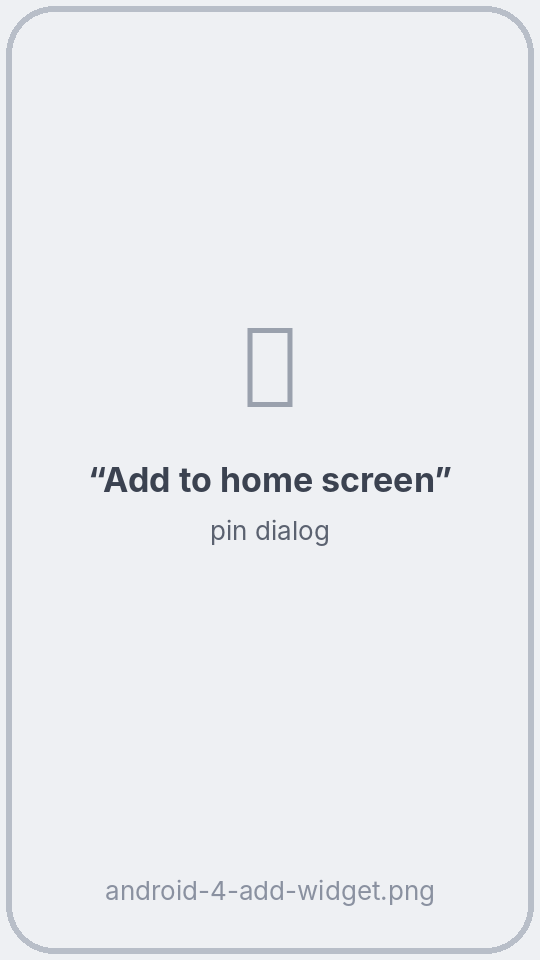
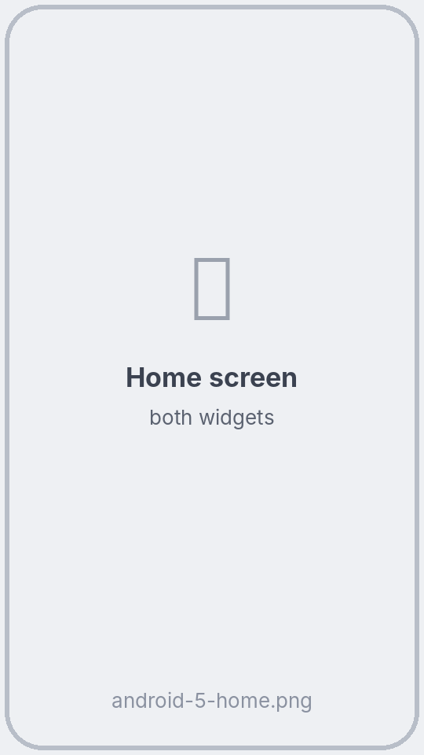

# 📅 USOS Widget na Androida

**Twój plan zajęć z USOS prosto na ekranie głównym — dla studentów każdej uczelni, która korzysta z USOSweb.**

[English](README.md) · **Polski** · [Українська](README.uk.md) · [Русский](README.ru.md)

### [⬇ Pobierz UsosWidget.apk](https://github.com/ProstoKery/usos-widget-android/releases/latest/download/UsosWidget.apk)

Masz iPhone'a? → **[USOS Widget na iPhone'a](https://github.com/ProstoKery/usos-widget-ios)**

---

## ✨ Co potrafi

- 🕗 **Najbliższe zajęcia** — mały widżet z bieżącymi lub następnymi zajęciami: przedmiot, forma, grupa, sala i godzina.
- 🗓 **Plan zajęć** — przewijany widżet ze wszystkimi nadchodzącymi zajęciami, pogrupowanymi według dni.
- 🔔 **Powiadomienia o zmianach** — gdy zajęcia w ciągu najbliższych 7 dni zostaną **przeniesione, odwołane, dodane lub zmieni się sala**.
- 🌍 **Twój język** — Polski, English, Українська, Русский (zgodnie z językiem telefonu).
- 🔐 **Bez logowania** — aplikacja nigdy nie pyta o hasło. Korzysta z prywatnego linku do kalendarza z USOSweb.

## 📲 Instalacja — około 5 minut

### Krok 1. Skopiuj link do swojego planu z USOSweb

Zrób to na telefonie, w Chrome lub innej przeglądarce. Zrzuty ekranu pochodzą z USOSweb jednej uczelni — u Ciebie wygląda tak samo lub bardzo podobnie.

1. Otwórz USOSweb swojej uczelni (np. **usosweb.uw.edu.pl** albo **usosweb.vistula.edu.pl**) i dotknij **Zaloguj się**. Zaloguj się kontem uczelnianym.

2. U góry otwórz **MÓJ USOSWEB**, a po lewej **PLAN ZAJĘĆ**. Jeśli nie widzisz górnego menu, dotknij **☰** albo obróć telefon poziomo.

   

3. Dotknij **eksportuj** w prawym górnym rogu.

   

4. Otworzy się okno **Eksport planu zajęć**. Dotknij przycisku kopiowania obok linku. Link zawiera `/services/tt/upcoming_ical?`

   

> 🔒 Każdy, kto ma ten link, zobaczy Twój plan. Nie wrzucaj go na czaty grupowe.

### Krok 2. Zainstaluj aplikację

1. Na telefonie dotknij **[UsosWidget.apk](https://github.com/ProstoKery/usos-widget-android/releases/latest/download/UsosWidget.apk)** — rozpocznie się pobieranie.

   

2. Otwórz pobrany plik. Android zapyta, czy przeglądarka może instalować aplikacje: dotknij **Ustawienia** → włącz **Zezwalaj z tego źródła** → wróć → **Zainstaluj**.

   Jeśli Google Play Protect ostrzeże przed nieznaną aplikacją, dotknij **Więcej szczegółów** → **Zainstaluj mimo to**. Ostrzeżenie pojawia się, bo aplikacji nie ma w Google Play. Cały jej kod jest w tym repozytorium.

   

### Krok 3. Wklej link

Otwórz **USOS Widget**, wklej link w pole i dotknij **Zapisz i odśwież**. Gdy Android zapyta o powiadomienia, dotknij **Zezwól** — tak dowiesz się o zmianach w planie.

> 💡 Zamiast kopiować możesz też użyć **Udostępnij** na linku i wybrać **USOS Widget**.

### Krok 4. Dodaj widżety

W aplikacji dotknij **Dodaj „Najbliższe zajęcia”** i/lub **Dodaj „Plan zajęć”**, a potem **Dodaj do ekranu głównego**.

Albo tradycyjnie: przytrzymaj puste miejsce na ekranie głównym → **Widżety** → **USOS Widget** → przeciągnij widżet na ekran.

 

### Krok 5. Xiaomi, Huawei, Samsung i inne: pozwól działać w tle

Niektóre telefony wstrzymują pracę w tle aplikacji, których rzadko używasz — wtedy widżet przestaje się aktualizować. W aplikacji dotknij **Ustawienia aplikacji** → **Bateria** → **Bez ograniczeń**. Na Xiaomi włącz też **Autostart**.

## 🔄 Jak widżet się aktualizuje

Widżet to obrazek, który aplikacja rysuje w tle. **Samo patrzenie na niego niczego nie uruchamia**: telefon pokazuje ostatnią wersję narysowaną przez aplikację.

| Co się zmienia | Kiedy |
|---|---|
| Przełączenie na następne zajęcia, znacznik „teraz” | Dokładnie w chwili rozpoczęcia lub końca zajęć (gdy tylko ekran jest włączony) |
| Nowe dane z USOS | Mniej więcej co 30 minut. Gdy telefon leży uśpiony, Android może to odłożyć do chwili, gdy znów go użyjesz |
| Od razu | Dotknij widżetu — aplikacja się otworzy i od razu pobierze plan |
| Powiadomienie o zmianie | Gdy pobieranie wykryje, że zajęcia w ciągu 7 dni przeniesiono, odwołano, dodano lub zmieniono salę |

## ❓ Pytania

**Widżet pokazuje „Brak połączenia z USOS”.** Sprawdź internet. USOS też czasem nie działa — na widżecie zostaje ostatnio pobrany plan.

**Widzę cudzy plan.** Link należy do kogoś innego. Skopiuj własny link (krok 1) i wklej go w aplikacji jeszcze raz.

**Jak zmienić język?** Aplikacja używa języka telefonu. Na Androidzie 13 i nowszym możesz też ustawić go osobno: **Ustawienia → Aplikacje → USOS Widget → Język**.

**Jak zaktualizować aplikację?** Pobierz nowy **UsosWidget.apk** z linku powyżej i zainstaluj na starą wersję. Link zostaje zapisany.

**Jak ją usunąć?** Odinstaluj jak każdą inną aplikację. Nic nie jest przechowywane poza Twoim telefonem.

## 🔒 Prywatność

- Aplikacja łączy się tylko z serwerem USOS Twojej uczelni — tym z Twojego linku. Bez kont, bez analityki, bez reklam.
- Twój link jest zapisany tylko w telefonie. Aplikacja nigdy nie pokazuje go w całości, więc zrzuty ekranu można bezpiecznie udostępniać.

## 🛠 Dla programistów

Opis budowania, testów i struktury projektu: [README po angielsku](README.md#-for-developers).

## ⚠️ Zastrzeżenie

Nieoficjalny projekt studencki, niezwiązany z zespołem USOS (MUCI) ani z żadną uczelnią. Testowany w Uczelni Vistula; powinien działać wszędzie, gdzie USOSweb pozwala wyeksportować plan.

## 📄 Licencja

[MIT](LICENSE) © 2026 Kyrylo Serhiienko
