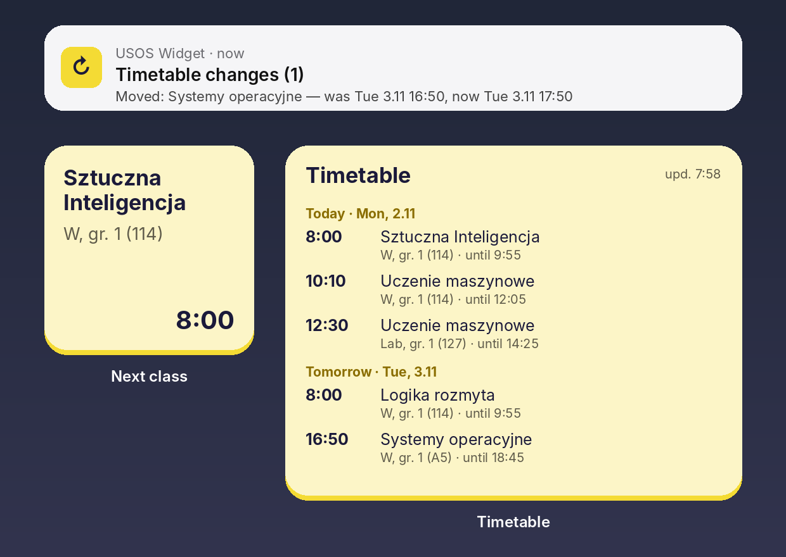
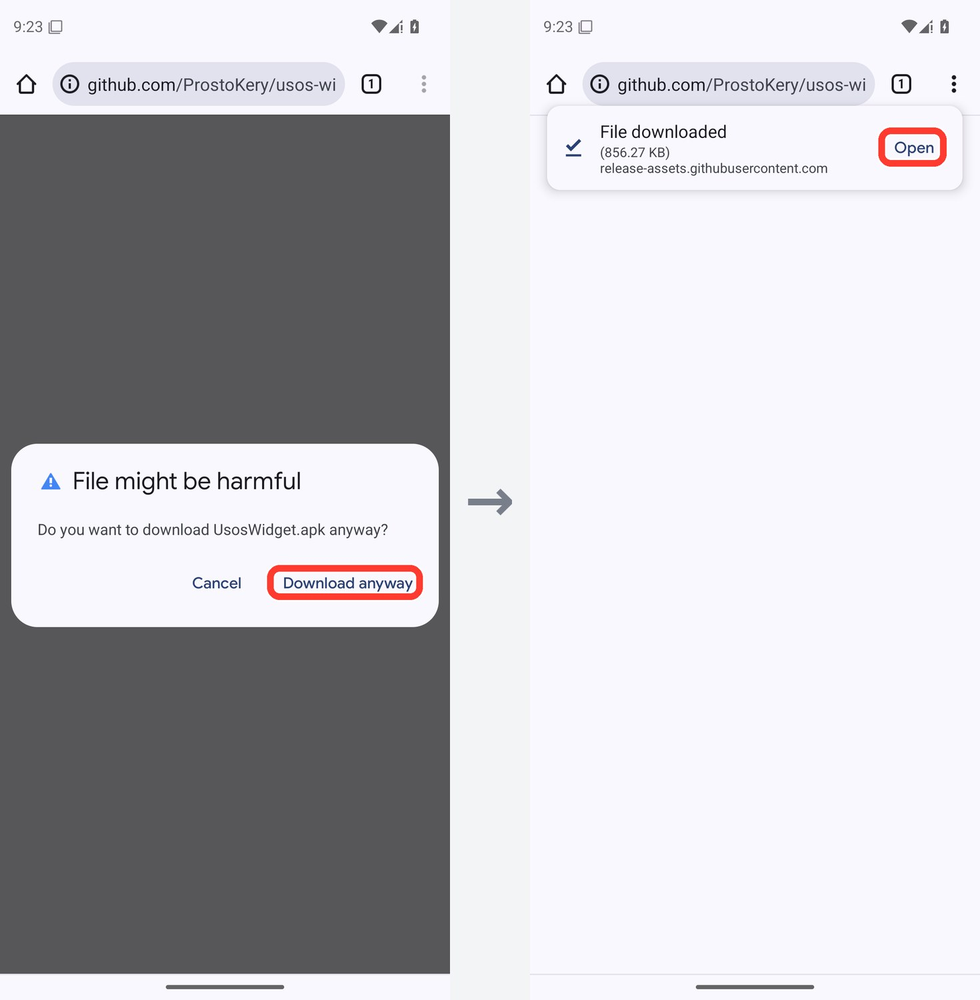
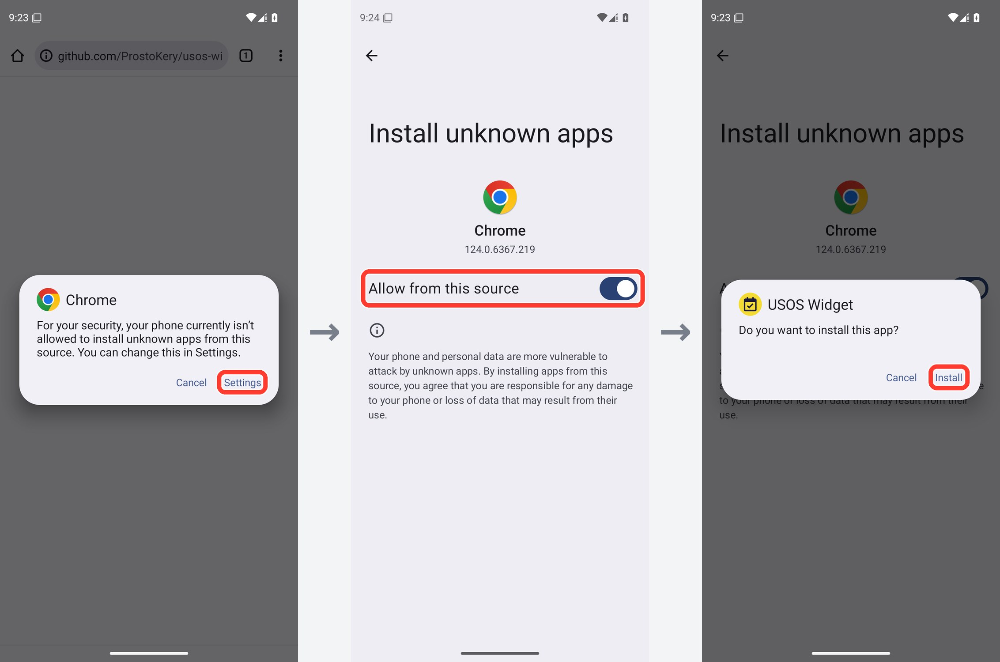
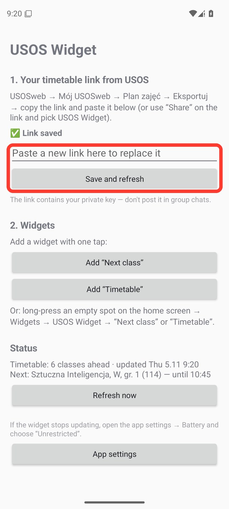
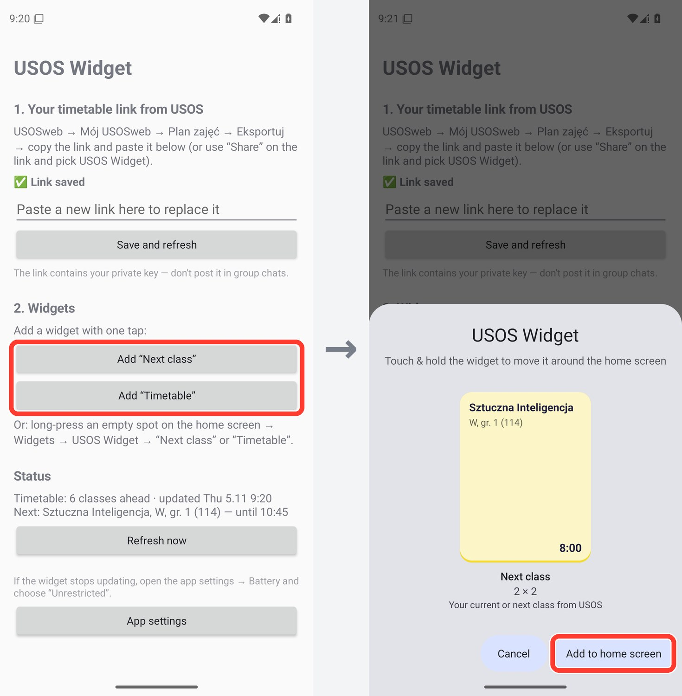
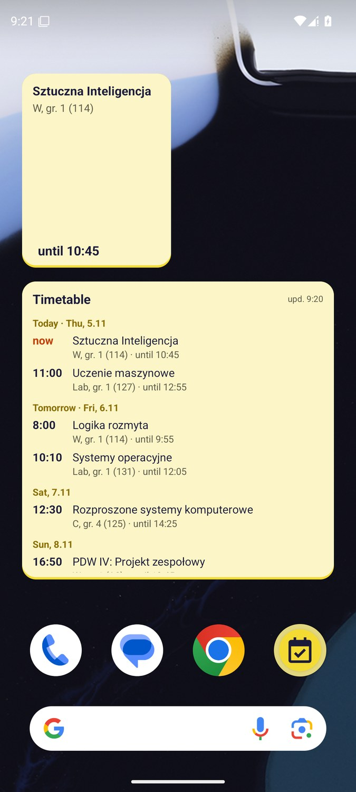

# 📅 USOS Widget для Android

**Твоё расписание из USOS прямо на рабочем столе — для студентов любого вуза, где есть USOSweb.**

[English](README.md) · [Polski](README.pl.md) · [Українська](README.uk.md) · **Русский**

### [⬇ Скачать UsosWidget.apk](https://github.com/ProstoKery/usos-widget-android/releases/latest/download/UsosWidget.apk)

Есть iPhone? → **[USOS Widget для iPhone](https://github.com/ProstoKery/usos-widget-ios)**

---

## ✨ Что умеет

- 🕗 **Ближайшая пара** — маленький виджет с текущей или следующей парой: предмет, тип, группа, аудитория и время.
- 🗓 **Расписание** — виджет со списком всех ближайших пар, по дням.
- 🔔 **Уведомления об изменениях** — когда пару в ближайшие 7 дней **перенесли, отменили, добавили или сменили аудиторию**.
- 🌍 **Твой язык** — Polski, English, Українська, Русский (как на телефоне).
- 🔐 **Без входа** — приложение никогда не спрашивает пароль. Оно использует личную ссылку на календарь из USOSweb.

## 📲 Установка — около 5 минут

### Шаг 1. Скопируй ссылку на своё расписание из USOSweb

Делай это на телефоне, в Chrome или любом другом браузере. Скриншоты сделаны в USOSweb одного вуза — у тебя он выглядит так же или очень похоже.

1. Открой USOSweb своего вуза (например **usosweb.uw.edu.pl** или **usosweb.vistula.edu.pl**) и нажми **Zaloguj się**. Войди университетским аккаунтом.

2. Сверху открой **MÓJ USOSWEB**, затем слева **PLAN ZAJĘĆ**. Если не видишь верхнего меню, нажми **☰** или поверни телефон горизонтально.

   

3. Нажми **eksportuj** в правом верхнем углу.

   

4. Откроется окно **Eksport planu zajęć**. Нажми кнопку копирования рядом со ссылкой. Ссылка содержит `/services/tt/upcoming_ical?`

   

> 🔒 Любой, у кого есть эта ссылка, увидит твоё расписание. Не кидай её в общие чаты.

### Шаг 2. Установи приложение

1. На телефоне нажми **[UsosWidget.apk](https://github.com/ProstoKery/usos-widget-android/releases/latest/download/UsosWidget.apk)** — начнётся загрузка. Если Chrome предупредит, что файл может быть опасным, нажми **Всё равно скачать**, а потом **Открыть**.

   

2. Открой скачанный файл. Android спросит, можно ли браузеру устанавливать приложения: нажми **Настройки** → включи **Разрешить из этого источника** → вернись назад → **Установить**.

   Если Google Play Защита предупредит о неизвестном приложении, нажми **Подробнее** → **Всё равно установить**. Предупреждение появляется, потому что приложения нет в Google Play. Весь его код лежит в этом репозитории.

   

### Шаг 3. Вставь ссылку

Открой **USOS Widget**, вставь ссылку в поле и нажми **Сохранить и обновить**. Когда Android спросит про уведомления, нажми **Разрешить** — так ты будешь узнавать об изменениях в расписании.

> 💡 Вместо копирования можно нажать **Поделиться** на ссылке и выбрать **USOS Widget**.

### Шаг 4. Добавь виджеты

В приложении нажми **Добавить «Ближайшая пара»** и/или **Добавить «Расписание»**, потом **Добавить на главный экран**.

Или обычным способом: долгое нажатие на пустом месте рабочего стола → **Виджеты** → **USOS Widget** → перетащи виджет на экран.

 

### Шаг 5. Xiaomi, Huawei, Samsung и другие: разреши работу в фоне

Некоторые телефоны останавливают фоновую работу приложений, которые редко открываешь, — тогда виджет перестаёт обновляться. В приложении нажми **Настройки приложения** → **Батарея** → **Без ограничений**. На Xiaomi ещё включи **Автозапуск**.

## 🔄 Как обновляется виджет

Виджет — это картинка, которую приложение рисует в фоне. **Просто смотреть на него — ничего не запускает**: телефон показывает последнюю версию, которую нарисовало приложение.

| Что меняется | Когда |
|---|---|
| Переключение на следующую пару, отметка «сейчас» | Ровно в момент начала или конца пары (как только экран включён) |
| Новые данные из USOS | Примерно раз в 30 минут. Пока телефон лежит в спящем режиме, Android может отложить это до момента, когда ты снова им воспользуешься |
| Прямо сейчас | Нажми на виджет — приложение откроется и сразу скачает расписание |
| Уведомление об изменении | Когда загрузка обнаружит, что пару в ближайшие 7 дней перенесли, отменили, добавили или сменили аудиторию |

## ❓ Вопросы

**Виджет пишет «Нет связи с USOS».** Проверь интернет. USOS тоже иногда не работает — на виджете остаётся последнее скачанное расписание.

**Вижу чужое расписание.** Ссылка чужая. Скопируй свою ссылку (шаг 1) и вставь в приложении ещё раз.

**Как поменять язык?** Приложение использует язык телефона. На Android 13 и новее его можно выбрать отдельно: **Настройки → Приложения → USOS Widget → Язык**.

**Как обновить приложение?** Скачай новый **UsosWidget.apk** по ссылке выше и установи поверх старого. Ссылка останется сохранённой.

**Как удалить?** Удали как любое другое приложение. Ничего не хранится нигде, кроме твоего телефона.

## 🔒 Приватность

- Приложение обращается только к серверу USOS твоего вуза — тому, что в ссылке. Без аккаунтов, аналитики и рекламы.
- Ссылка хранится только на телефоне. Приложение никогда не показывает её целиком, так что скриншоты приложения можно спокойно показывать.

## 🛠 Для разработчиков

Сборка, тесты и структура проекта: [README на английском](README.md#-for-developers).

## ⚠️ Оговорка

Неофициальный студенческий проект, не связан с командой USOS (MUCI) и каким-либо вузом. Проверен в университете Vistula; должен работать везде, где USOSweb позволяет экспортировать расписание.

## 📄 Лицензия

[MIT](LICENSE) © 2026 Kyrylo Serhiienko
