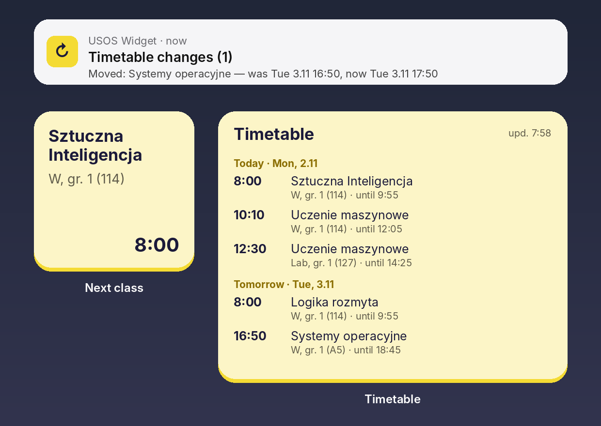
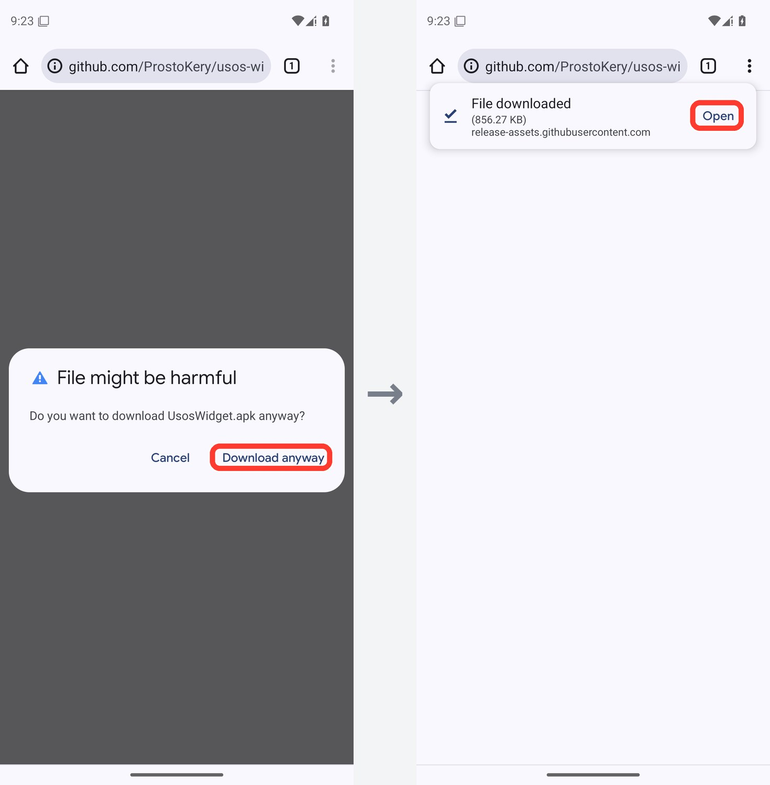
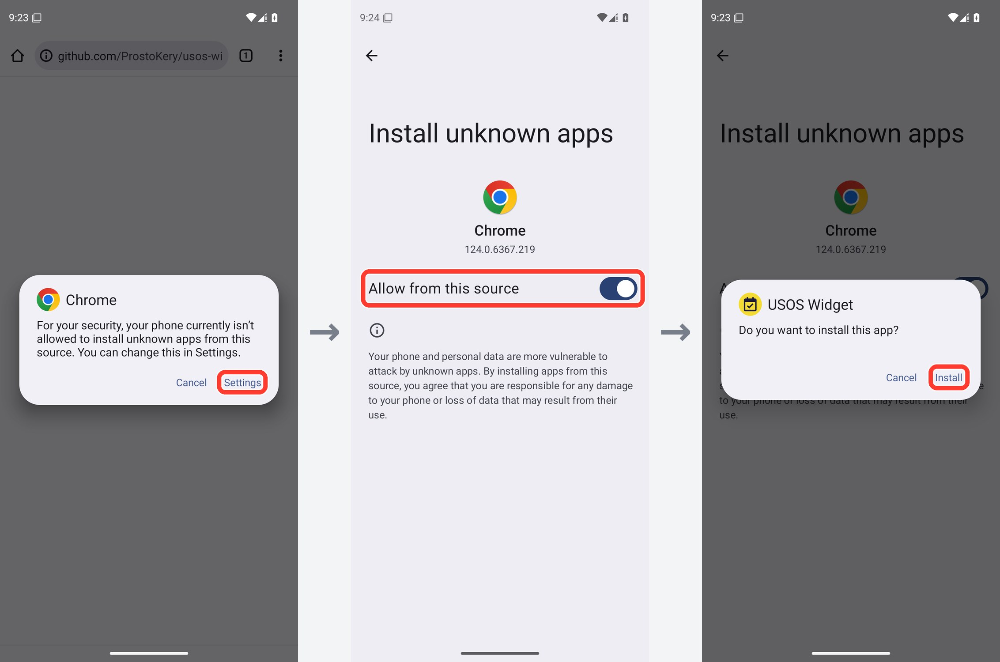
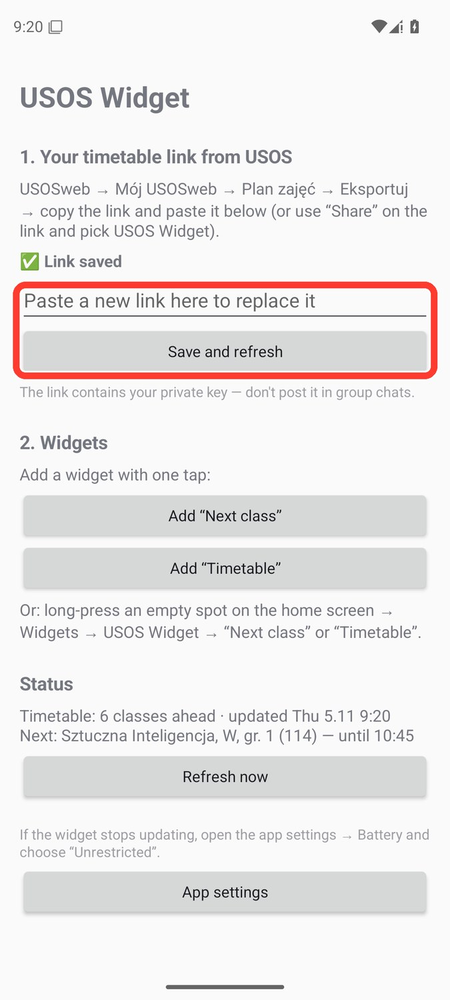
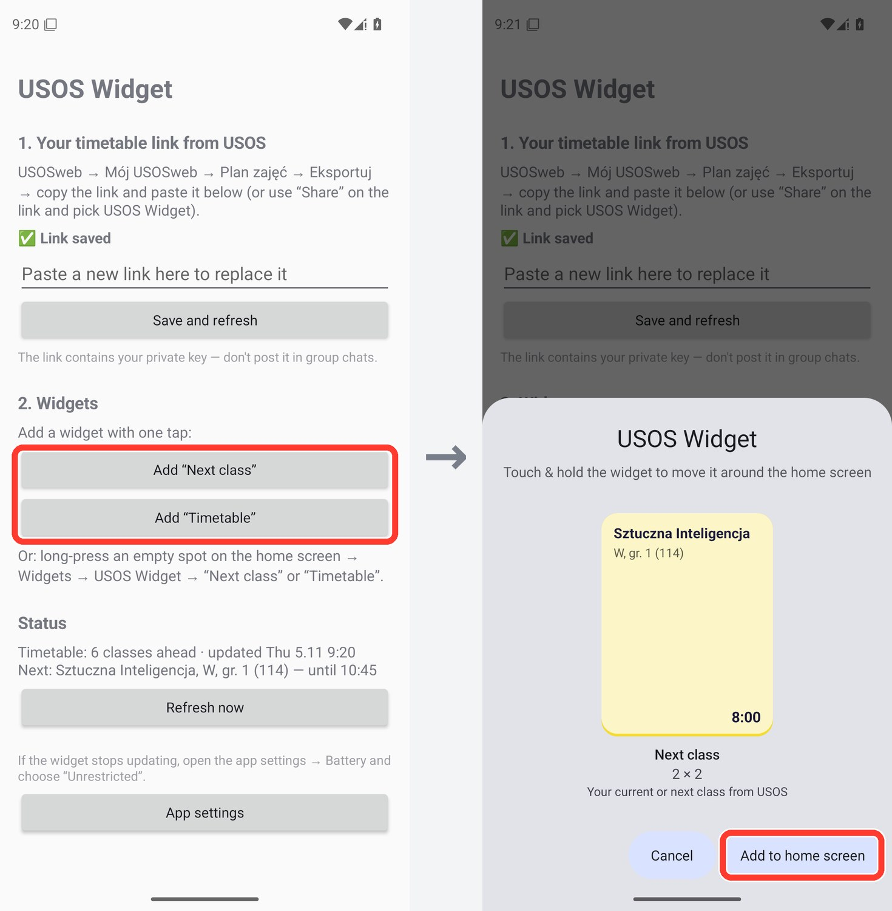
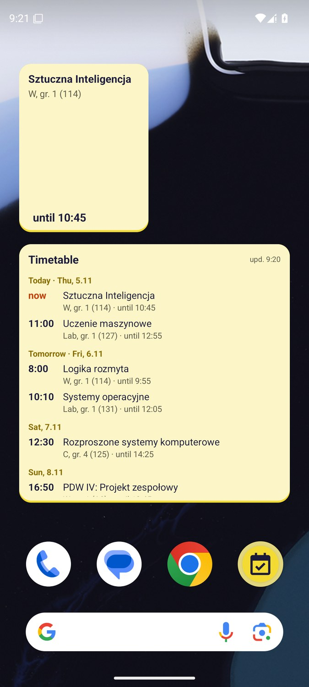

# 📅 USOS Widget для Android

**Твій розклад з USOS просто на робочому столі — для студентів будь-якого університету, що користується USOSweb.**

[English](README.md) · [Polski](README.pl.md) · **Українська** · [Русский](README.ru.md)

### [⬇ Завантажити UsosWidget.apk](https://github.com/ProstoKery/usos-widget-android/releases/latest/download/UsosWidget.apk)

Маєш iPhone? → **[USOS Widget для iPhone](https://github.com/ProstoKery/usos-widget-ios)**

---

## ✨ Що вміє

- 🕗 **Найближча пара** — маленький віджет з поточною або наступною парою: предмет, тип, група, аудиторія і час.
- 🗓 **Розклад** — віджет зі списком усіх найближчих пар, згрупованих за днями.
- 🔔 **Сповіщення про зміни** — коли пару в найближчі 7 днів **перенесли, скасували, додали або змінили аудиторію**.
- 🌍 **Твоя мова** — Polski, English, Українська, Русский (як на телефоні).
- 🔐 **Без входу** — застосунок ніколи не питає пароль. Він використовує приватне посилання на календар з USOSweb.

## 📲 Встановлення — близько 5 хвилин

### Крок 1. Скопіюй посилання на свій розклад з USOSweb

Роби це на телефоні, у Chrome або іншому браузері. Скриншоти зроблені в USOSweb одного університету — у тебе він виглядає так само або дуже схоже.

1. Відкрий USOSweb свого університету (наприклад **usosweb.uw.edu.pl** або **usosweb.vistula.edu.pl**) і натисни **Zaloguj się**. Увійди університетським акаунтом.

2. Угорі відкрий **MÓJ USOSWEB**, потім ліворуч **PLAN ZAJĘĆ**. Якщо не бачиш верхнього меню, натисни **☰** або поверни телефон горизонтально.

   

3. Натисни **eksportuj** у правому верхньому куті.

   

4. Відкриється вікно **Eksport planu zajęć**. Натисни кнопку копіювання поруч із посиланням. Посилання містить `/services/tt/upcoming_ical?`

   

> 🔒 Кожен, у кого є це посилання, побачить твій розклад. Не кидай його в групові чати.

### Крок 2. Встанови застосунок

1. На телефоні натисни **[UsosWidget.apk](https://github.com/ProstoKery/usos-widget-android/releases/latest/download/UsosWidget.apk)** — почнеться завантаження. Якщо Chrome попередить, що файл може бути шкідливим, натисни **Усе одно завантажити**, а потім **Відкрити**.

   

2. Відкрий завантажений файл. Android запитає, чи може браузер встановлювати застосунки: натисни **Налаштування** → увімкни **Дозволити з цього джерела** → повернись → **Встановити**.

   Якщо Google Play Protect попередить про невідомий застосунок, натисни **Докладніше** → **Усе одно встановити**. Попередження з'являється, бо застосунку немає в Google Play. Увесь його код є в цьому репозиторії.

   

### Крок 3. Встав посилання

Відкрий **USOS Widget**, встав посилання в поле і натисни **Зберегти й оновити**. Коли Android запитає про сповіщення, натисни **Дозволити** — так ти дізнаватимешся про зміни в розкладі.

> 💡 Замість копіювання можна натиснути **Поділитися** на посиланні й обрати **USOS Widget**.

### Крок 4. Додай віджети

У застосунку натисни **Додати «Найближча пара»** та/або **Додати «Розклад»**, потім **Додати на головний екран**.

Або звичайним способом: довго натисни на порожнє місце робочого столу → **Віджети** → **USOS Widget** → перетягни віджет на екран.

 

### Крок 5. Xiaomi, Huawei, Samsung та інші: дозволь роботу у фоні

Деякі телефони зупиняють фонову роботу застосунків, які рідко відкриваєш, — тоді віджет перестає оновлюватися. У застосунку натисни **Налаштування застосунку** → **Батарея** → **Без обмежень**. На Xiaomi також увімкни **Автозапуск**.

## 🔄 Як оновлюється віджет

Віджет — це картинка, яку застосунок малює у фоні. **Просто дивитися на нього — нічого не запускає**: телефон показує останню версію, яку намалював застосунок.

| Що змінюється | Коли |
|---|---|
| Перемикання на наступну пару, позначка «зараз» | Точно в момент початку або кінця пари (щойно екран увімкнений) |
| Нові дані з USOS | Приблизно раз на 30 хвилин. Поки телефон лежить у сні, Android може відкласти це до моменту, коли ти знову ним скористаєшся |
| Прямо зараз | Натисни на віджет — застосунок відкриється і одразу завантажить розклад |
| Сповіщення про зміну | Коли завантаження виявить, що пару в найближчі 7 днів перенесли, скасували, додали або змінили аудиторію |

## ❓ Питання

**Віджет пише «Немає зв'язку з USOS».** Перевір інтернет. USOS теж іноді не працює — на віджеті залишається останній завантажений розклад.

**Бачу чужий розклад.** Посилання чуже. Скопіюй своє посилання (крок 1) і встав у застосунку ще раз.

**Як змінити мову?** Застосунок використовує мову телефону. На Android 13 і новіших можна обрати її окремо: **Налаштування → Застосунки → USOS Widget → Мова**.

**Як оновити застосунок?** Завантаж новий **UsosWidget.apk** за посиланням вище і встанови поверх старого. Посилання залишиться збереженим.

**Як видалити?** Видали, як будь-який інший застосунок. Ніщо не зберігається ніде, крім твого телефона.

## 🔒 Приватність

- Застосунок звертається тільки до сервера USOS твого університету — того, що в посиланні. Без акаунтів, аналітики та реклами.
- Посилання зберігається тільки на телефоні. Застосунок ніколи не показує його повністю, тож скриншоти застосунку можна сміливо показувати.

## 🛠 Для розробників

Збирання, тести і структура проєкту: [README англійською](README.md#-for-developers).

## ⚠️ Застереження

Неофіційний студентський проєкт, не пов'язаний з командою USOS (MUCI) чи будь-яким університетом. Перевірено в університеті Vistula; має працювати всюди, де USOSweb дає експортувати розклад.

## 📄 Ліцензія

[MIT](LICENSE) © 2026 Kyrylo Serhiienko
